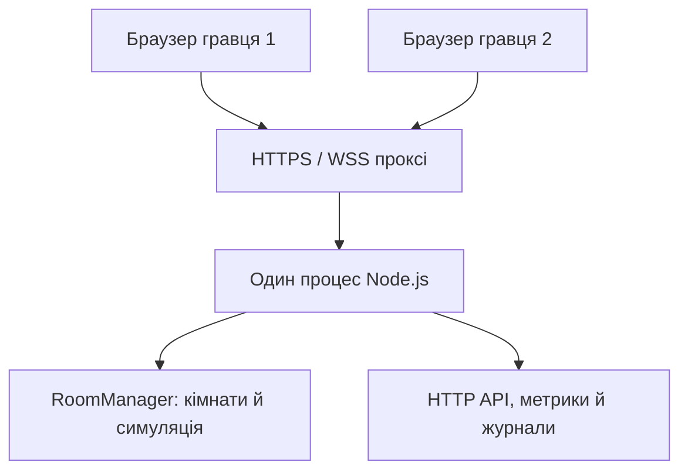

# Space Arena

Браузерна 2D-гра на JavaScript із використанням HTML5 Canvas API.

Проєкт розробляється поетапно в межах лабораторних робіт із JavaScript.

## Використані технології

- JavaScript (ES Modules)

- HTML5, CSS3

- Canvas API

- Vite

- Web Audio API

- Fetch API

- ESLint, Prettier

- Node.js, HTTP, WebSocket (`ws`), Streams

- npm workspaces

- Git та GitHub

- TypeScript та Zod для типізованих структур і валідації

- Vitest, fast-check та V8 Coverage для автоматизованого тестування

- Playwright (Chromium) для E2E-тестів

- GitHub Actions для CI

## Запуск проєкту

Необхідні Node.js та npm.

```bash

npm install

npm run dev:server  # перший термінал

npm run dev         # другий термінал

```

Відкрити локальну адресу, яку виведе Vite (порт може змінюватися, якщо 5175 зайнятий), наприклад:

http://localhost:5175/

## Керування

| Клавіша | Дія |

|---|---|

| W / ↑ | Прискорення |

| A / ← | Поворот ліворуч |

| D / → | Поворот праворуч |

| Space | Стрільба |

---

## Лабораторна робота №1 — Event Loop та Game Loop

### Мета роботи

Розробити базовий ігровий цикл із використанням

`requestAnimationFrame`, реалізувати фізичне оновлення

з фіксованим часовим кроком і дослідити вплив

Event Loop на продуктивність браузерної гри.

### Реалізовані можливості

- Відображення космічного корабля на Canvas.

- Керування клавіатурою.

- Рух і поворот корабля.

- Фізична симуляція.

- Фіксований часовий крок 1/60 секунди.

- Інтерполяція положення між кадрами.

- Відображення FPS, Steps/s і Frame ms.

### Експеримент 1. Блокування Event Loop

Для дослідження блокування головного потоку

використано синхронний цикл `while` тривалістю

приблизно 20 мс.

Базові показники:

| Показник | Значення |

|---|---|

| FPS | 59.9 |

| Steps/s | 59.9 |

| Frame ms | 16.68 |

Показники під час блокування окремо не зафіксовано.

Блокування головного потоку перешкоджає

своєчасному виконанню інших завдань браузера.

### Експеримент 2. setInterval проти requestAnimationFrame

| Показник | requestAnimationFrame | setInterval |

|---|---:|---:|

| FPS | 59.9 | 62.5 |

| Steps/s | 59.9 | 60.5 |

| Frame ms | 16.68 | 16.00 |

У проведеному вимірюванні `setInterval`

забезпечив дещо вищу частоту викликів.

Однак `requestAnimationFrame` краще підходить

для синхронізації анімації з оновленням екрана.

### Експеримент 3. Фіксований і змінний часовий крок

Результати змінного часового кроку:

- FPS: 59.9

- Steps/s: 59.9

- Frame ms: 16.68

За стабільної частоти кадрів суттєвої різниці

в показниках не виявлено.

Для фінальної версії обрано фіксований крок,

оскільки він забезпечує більш передбачуване

оновлення фізичної симуляції.

### Висновок до лабораторної №1

Розроблено базовий ігровий цикл браузерної гри

Space Arena. Реалізовано керування кораблем,

фізичну симуляцію, рендеринг Canvas та

моніторинг продуктивності.

Для подальшого розвитку гри обрано

`requestAnimationFrame` і фіксований часовий крок.

---

## Лабораторна робота №2 — Об'єкти, прототипи та this

### Архітектура сутностей

У грі використано об'єктно-орієнтований підхід.

Основні компоненти:

- `Vector2` — операції над двовимірними векторами.

- `Entity` — базовий клас ігрових сутностей.

- `Ship` — корабель гравця.

- `Bullet` — снаряд з обмеженим часом існування.

- `Asteroid` — астероїд із запасом здоров'я.

- `Pickup` — бонус відновлення здоров'я.

- `Particle` — частинка візуального ефекту.

- `World` — керування сутностями через Map та Set.

- `Homing` — компонент самонаведення.

### Чотири правила this

1\. Звичайний виклик функції: у strict mode

   `this` дорівнює `undefined`.

2\. Виклик методу об'єкта: `this` посилається

   на об'єкт перед крапкою.

3\. Виклик через `call()`, `apply()` або `bind()`:

   контекст задається явно.

4\. Виклик через `new`: `this` посилається

   на новостворений об'єкт.

Стрілкові функції не мають власного `this`,

а використовують контекст зовнішньої області.

### Експеримент із втратою this

Під час передачі методу `ship.fire`

в окрему змінну втрачається прив'язка

до об'єкта корабля.

Виникає помилка:

```text

Cannot read properties of undefined (reading 'alive')

```

Виправлення:

```javascript

const boundFire = ship.fire.bind(ship);

const arrowFire = () => ship.fire();

```

### Прототипне наслідування

Клас `Ship` наслідує `Entity`.

Метод `fire()` знаходиться у `Ship.prototype`,

а не безпосередньо у властивостях екземпляра.

```javascript

Object.hasOwn(Ship.prototype, 'fire'); // true

Object.hasOwn(ship, 'fire');           // false

```

### Композиція замість глибокого наслідування

Для реалізації самонаведення використано

окремий компонент `Homing`.

Його можна застосовувати до різних сутностей

без створення додаткових підкласів.

Переваги:

- Повторне використання поведінки.

- Зменшення зв'язності компонентів.

- Простіше тестування.

- Можливість змінювати поведінку об'єктів.

- Відсутність глибокої ієрархії класів.

### Ігрові механіки

- Керування кораблем.

- Стрільба.

- Зіткнення об'єктів.

- Здоров'я корабля.

- Нарахування очок.

- Відродження через 2 секунди.

- Вибухи з частинок.

- Бонуси здоров'я.

- Самонаведення астероїда.

### Запуск експерименту

```bash

node client/src/sim/this-experiment.js

```

### Висновок до лабораторної №2

У межах роботи реалізовано об'єктно-орієнтовану

архітектуру ігрових сутностей.

Досліджено прототипне наслідування,

особливості контексту `this` та застосування

композиції для повторного використання поведінки.

---

## Лабораторна робота №3 — Асинхронність, ресурси та події

### Мета роботи

Дослідити асинхронне програмування JavaScript,

застосування Promise та async/await, організувати

завантаження ресурсів, реалізувати звуковий

супровід, систему подій і лобі гри.

### Асинхронне завантаження ресурсів

Реалізовано модулі:

- `client/src/async/loader.js` — завантаження ресурсів.

- `client/src/async/retry.js` — повторні спроби запитів.

- `client/public/manifest.json` — перелік ресурсів.

- `client/src/game/loading.js` — екран завантаження.

Використано:

- `Promise`

- `async/await`

- `Promise.all`

- `fetch`

- `AbortController`

- `AbortSignal`

Ресурси завантажуються перед початком гри.

Під час завантаження відображається

індикатор прогресу на Canvas.

### Графічні ресурси

Для відображення об'єктів використовуються

PNG-зображення:

- `ship.png`

- `bullet.png`

- `asteroid.png`

Модуль `client/src/game/render.js` відповідає

за відображення ігрових об'єктів.

### Звуковий супровід

Реалізовано модуль:

`client/src/audio/audio.js`

Використано Web Audio API.

Звукові ефекти:

- `shoot.wav` — постріл.

- `hit.wav` — зіткнення.

- `explosion.wav` — вибух.

Звукова система активується після дії

користувача відповідно до обмежень браузера.

### Система подій

Створено модуль:

`client/src/events/game-events.js`

Для обміну повідомленнями між компонентами

використано `EventTarget` та `CustomEvent`.

Основні події:

- `fired` — виконання пострілу.

- `hit` — зіткнення об'єктів.

- `exploded` — знищення об'єкта.

Система подій дозволяє відокремити

ігрову логіку від звукового супроводу.

### Ігрове лобі

Реалізовано:

- `client/src/lobby/lobby.js`

- `client/src/lobby/lobby-ui.js`

- `client/public/api/rooms.json`

У лобі можна переглянути доступні кімнати,

ввести ім'я гравця, вибрати кімнату

та перейти до локальної ігрової арени.

Дані кімнат завантажуються асинхронно

з JSON-файлу.

### Дослідження Event Loop

Створено модуль:

`client/src/async/event-loop-experiments.js`

Тестова сторінка:

`event-loop-test.html`

Проведено п'ять експериментів із порядком

виконання:

- Синхронного коду.

- Promise callbacks.

- `setTimeout`.

- `async/await`.

- `queueMicrotask`.

- `requestAnimationFrame`.

Відкрити тестову сторінку через Vite:

http://localhost:5175/event-loop-test.html (якщо тестова сторінка наявна у client/)

### Обробка асинхронних помилок

Створено модуль:

`client/src/async/error-tests.js`

Тестова сторінка:

`error-test.html`

Реалізовано п'ять тестів:

| Тест | Результат |

|---|---|

| HTTP 404 / некоректний тип відповіді | Виявлено HTML замість JSON |

| Timeout | TimeoutError |

| Abort | AbortError |

| Invalid JSON | SyntaxError |

| Retry | Успішне виконання після 3 спроб |

У першому тесті Vite повертає HTML

зі статусом 200 для невідомого маршруту.

Тому перевірка додатково контролює

тип відповіді.

Відкрити тестову сторінку:

http://localhost:5175/error-test.html (якщо тестова сторінка наявна у client/)

### Git та GitHub

Результати лабораторної роботи №3

збережено в репозиторії:

https://github.com/bondart01/space-arena

Коміт:

`b7b6086`

Тег:

`lab-03`

### Висновок до лабораторної №3

У процесі виконання роботи реалізовано

асинхронне завантаження графічних,

звукових та JSON-ресурсів.

Створено систему подій, інтегровано

Web Audio API, реалізовано лобі

з вибором ігрової кімнати.

Досліджено черги виконання JavaScript,

механізми скасування запитів,

тайм-аути та повторні спроби.

---

## Лабораторна робота №4 — Node.js, HTTP, WebSocket та Streams

### Мета роботи

Побудувати серверну частину гри Space Arena на Node.js, організувати обмін повідомленнями між клієнтами через WebSocket, реалізувати HTTP API, потокове журналювання подій і дослідити Event Loop, EventEmitter та Backpressure.

### Структура проєкту

Починаючи з лабораторної №4 використано npm workspaces:

```text

space-arena/

├── client/

│   ├── src/                 # Логіка браузерної гри

│   │   └── network/socket.js

│   ├── public/              # Графіка, аудіо та JSON-ресурси

│   ├── dist/                # Результат збірки (не в Git)

│   └── vite.config.js       # Vite та proxy для /api і /ws

├── server/

│   ├── src/

│   │   ├── index.js         # HTTP API, статичні файли, завершення

│   │   ├── config.js        # PORT, LOG_DIR, HOST

│   │   ├── room.js          # Кімната на основі EventEmitter

│   │   ├── room-manager.js  # Створення й видалення кімнат

│   │   ├── websocket.js     # WebSocket-з'єднання та повідомлення

│   │   ├── match-logger.js  # NDJSON та pipeline

│   │   ├── replay.js        # Потокове відтворення журналу

│   │   └── backpressure-test.js

│   └── logs/                # Локальні журнали (не в Git)

├── package.json

└── README.md

```

### Запуск

Встановлення залежностей у корені репозиторію:

```bash

npm install

```

Режим розробки — у двох окремих терміналах:

```bash

npm run dev:server

npm run dev

```

Клієнт запускається через Vite (типово порт 5175, якщо доступний); проксі перенаправляє `/api/rooms` і `/ws` на Node.js сервер.

Запуск зібраної гри без Vite:

```bash

npm run build

npm run dev:server

```

Адреса гри: `http://127.0.0.1:3000/`. Сервер читає статичні файли з `client/dist`, використовує потокове передавання файлів та перевіряє шлях, щоб не дозволяти вихід за межі каталогу збірки.

### HTTP API

| Метод | Маршрут | Призначення |

|---|---|---|

| GET | `/health` | Стан сервера та uptime |

| GET | `/api/rooms` | Список ігрових кімнат |

| POST | `/api/rooms` | Створення кімнати (`name`, `maxPlayers`) |

| GET | `/` | Головна сторінка зібраного клієнта |

Тіло POST-запиту обробляється як JSON з обмеженням розміру 16 КіБ. Під час фінального тестування сервер повернув `status: ok`, а створена кімната `Lab 4 Final Test` з'явилася в GET `/api/rooms` з лімітом 4 гравці.

### WebSocket і життєвий цикл кімнат

WebSocket працює за маршрутом `/ws`. Клієнт передає `join` з `roomId` і `name`, а також `chat` з полем `text`. Сервер надсилає події `joined`, `player_joined`, `chat`. Використано перевірку JSON, обмеження розміру повідомлення, тайм-аут входу, ping/pong та обмеження частоти повідомлень. Клієнтський `GameSocket` підтримує чергу повідомлень і повторне підключення.

Під час фінального тесту за адресою `ws://127.0.0.1:3000/ws` успішно отримано `joined`, `player_joined` та `chat` із текстом `Lab 4 WebSocket final test!`.

`Room` успадковує `EventEmitter`, а `RoomManager` керує створенням кімнат і видаляє порожні кімнати після виходу останнього гравця.

### Журналювання NDJSON та Streams

`MatchLogger` записує події `roomCreated`, `roomDeleted`, `playerJoined`, `playerLeft`, `chat` у файл `server/logs/matches.ndjson`. Для потокового запису застосовано `PassThrough`, `Transform`, `createWriteStream` і `pipeline`. Кожен рядок містить окремий JSON-об'єкт і часову мітку.

Модуль `server/src/replay.js` використовує `createReadStream` і `readline` для послідовного читання рядків без завантаження всього файлу в оперативну пам'ять.

Приклад запуску replay із кореня репозиторію:

```bash

node --input-type=module -e "import { replayLogs } from './server/src/replay.js'; await replayLogs('./server/logs/matches.ndjson');"

```

Під час одного з тестів replay прочитано 16 подій: `roomCreated` — 5, `playerJoined` — 4, `playerLeft` — 3, `roomDeleted` — 3, `chat` — 1.### Результати експериментів

| Дослідження | Зафіксований результат |

|---|---|

| Потокове читання великого NDJSON | 100 000 записів, файл приблизно 95,18 МБ |

| Використання пам'яті | Максимальне спостережене RSS ≈ 49,82 МБ під час тесту читання |

| Синхронне блокування Event Loop | Затримка близько 300 мс; два паралельні HTTP-запити завершилися приблизно за 353,67 мс |

| `EventEmitter` без обробника `error` | Процес завершився з помилкою |

| `EventEmitter` з обробником `error` | Помилку перехоплено, виконання продовжилося |

| Backpressure | 100 блоків записано, 100 оброблено, 25 подій очікування `drain` |

| Graceful Shutdown | `SIGINT` оброблено, повідомлення `Match logs saved successfully` отримано |

| HTTP API | `/health`, GET і POST `/api/rooms` працюють |

| WebSocket | Підключення, приєднання до кімнати та чат працюють |

Показник RSS — найбільше значення серед виконаних вимірювань, а не гарантований абсолютний пік пам'яті.

Запуск експерименту Backpressure:

```bash

node server/src/backpressure-test.js

```

### Перевірка захисту Path Traversal

| HTTP-запит | Отриманий код |

|---|---:|

| `/index.html` | 200 |

| `/assets/` | 404 |

| `/%2e%2e/server/package.json` | 404 |

| `/%2e%2e%2fserver%2fpackage.json` | 403 |

| `/%5c..%5cserver%5cpackage.json` | 403 |

| `/nonexistent-file.txt` | 404 |

Усі перевірені спроби виходу за межі `client/dist` не повернули вміст сторонніх файлів.

### Коректне завершення роботи

При натисканні Ctrl+C сервер обробляє `SIGINT`, припиняє HTTP-обслуговування, закриває активні WebSocket-з'єднання та завершує запис журналу. Зафіксовано повідомлення `Received SIGINT. Shutting down...` і `Match logs saved successfully`.

### Висновок до лабораторної №4

У межах лабораторної роботи реалізовано серверну архітектуру гри Space Arena на Node.js, HTTP API, WebSocket-обмін і керування ігровими кімнатами. Досліджено поведінку Event Loop, EventEmitter, потокове читання великих файлів і механізм Backpressure. Перевірено збереження NDJSON-журналів, коректне завершення роботи та захист статичних файлів від перевірених спроб Path Traversal. Результати підтверджують працездатність основних мережевих і потокових компонентів проєкту.

---

## Лабораторна робота №5 — Синхронізація стану гри та мережеві протоколи

### Мета роботи

Розширити Space Arena до мережевої гри з авторитетним сервером, реалізувати прогнозування руху на клієнті, узгодження станів, інтерполяцію віддалених гравців, статистику мережі та компактне передавання команд.

### Реалізовані компоненти

- ****Server-authoritative simulation**** — сервер обробляє команди гравців і формує знімки стану гри (Snapshot); серверний цикл працює приблизно з частотою 30 Гц.

- ****Client-Side Prediction**** — клієнт локально прогнозує рух власного корабля до отримання підтвердження від сервера.

- ****Server Reconciliation**** — клієнт використовує порядкові номери команд (`seq`) та підтвердження (`ACK`), щоб узгоджувати прогноз із серверним станом.

- ****Remote Interpolation**** — згладжує відображення кораблів інших гравців; встановлена затримка інтерполяції — 100 мс.

- ****Bullet Prediction**** — локально прогнозує постріли та узгоджує їх із серверними даними.

- ****Network Statistics**** — відображає RTT, jitter RTT, вік та інтервал Snapshot, пропуски послідовності Snapshot, вхідний/вихідний трафік, непідтверджені команди й величину корекції.

- ****Binary Input Protocol**** — команди керування передаються через WebSocket у бінарному форматі; службові повідомлення та Snapshot залишаються у JSON.

Основні файли: `client/src/main.js`, `client/src/network/prediction.js`, `client/src/network/interpolation.js`, `client/src/network/bullet-prediction.js`, `client/src/network/network-stats.js`, `client/src/network/socket.js`, `server/src/room.js`, `server/src/room-manager.js`, `server/src/websocket.js`, `shared/src/binary-protocol.js`.

### Запуск і тестування

У корені репозиторію встановити залежності командою `npm install`, потім запустити сервер і клієнт у ****двох окремих терміналах****:

```bash

npm run dev:server

```

```bash

npm run dev --workspace=client

```

Відкрити `http://localhost:5175/`, обрати кімнату `Lab 5 Battle`, ввести ім'я гравця. Для перевірки взаємодії двох гравців можна відкрити гру у двох вкладках браузера. HTTP API кімнат: `http://localhost:3000/api/rooms`; WebSocket: `/ws`.

### Формат бінарної команди

| Байти | Призначення |

|---|---|

| 0 | Тип повідомлення (`1` — input) |

| 1–4 | Порядковий номер команди `seq`, uint32, little-endian |

| 5 | Бітові прапорці: thrust = 1, left = 2, right = 4, shoot = 8 |

Загальний розмір — ****6 байтів****. Декодер перевіряє розмір повідомлення і тип команди.

### Результати перевірки Binary Protocol

| Перевірка | Результат |

|---|---:|

| JSON-команда керування | 78 байтів |

| Бінарна команда керування | 6 байтів |

| Зменшення розміру корисних даних | 92,31% (у 13 разів) |

| Кодування/декодування всіх комбінацій керування | 16/16 |

| Відхилення повідомлень некоректного розміру або типу | 4/4 |

Порівняння 78 і 6 байтів стосується ****вмісту однієї команди****, без урахування накладних витрат WebSocket та іншого трафіку.

### Експерименти із затримкою Snapshot

У `client/src/main.js` штучна затримка застосовувалася ****після отримання**** Snapshot. Вимірювання RTT та інтервалу надходження Snapshot виконуються до цієї затримки.

| Показник | Постійна затримка 250 мс | Випадкова затримка 250–400 мс |

|---|---:|---:|

| RTT | 0,6 мс | 0,6 мс |

| Jitter RTT | 0,1 мс | 0,1 мс |

| Інтервал Snapshot | 32,2 мс | 32,2 мс |

| Snapshot Age (до штучної затримки) | 20,7 мс | 25,3 мс |

| Pending inputs | 15 | 17 |

| Correction (на момент скриншота) | 0,00 px | 0,00 px |

| Пропуски послідовності Snapshot | 0 | 0 |

| Upload | 0,18 KB/s | 0,16 KB/s |

| Download | 21,89 KB/s | 24,59 KB/s |

За випадкової затримки кількість непідтверджених команд зросла з 15 до 17. На обох зафіксованих станах Client-Side Prediction був активним. Ці результати є ****моментними спостереженнями****, а не статистичною оцінкою плавності гри. Показник пропусків Snapshot не тотожний вимірюванню реальних втрат мережевих пакетів.

Після експериментів повернуто стандартну конфігурацію: `NETWORK_DELAY_MS = 100`, `INTERPOLATION_DELAY_MS = 100`, без додаткової випадкової затримки.

### Перевірка якості

- `npm run lint` — успішно, без повідомлень про помилки (перевіряє `client/src`).

- `npm run build` — успішно: Vite 8.3.7, 23 модулі, збірка за 130 мс.

- Перевірено запуск гри після інтеграції бінарних команд.

### Висновок до лабораторної №5

Реалізовано основні механізми синхронізації стану мережевої гри: авторитетний сервер, клієнтське прогнозування, узгодження з сервером, інтерполяцію та прогнозування пострілів. Додано моніторинг мережевих показників і компактний бінарний формат команд керування. Тести підтвердили правильне кодування всіх 16 комбінацій керування, відхилення чотирьох некоректних повідомлень та зменшення розміру команди на 92,31%. Експерименти зі штучною затримкою дозволили дослідити кількість непідтверджених команд і поведінку клієнта під час затриманого надходження серверних оновлень.

---

## Перевірка якості коду

```bash

npm run lint

npx prettier --check client/src

npm run build

```

## Версії лабораторних робіт

| Лабораторна | Git-тег |

|---|---|

| №1 | `lab-01` |

| №2 | `lab-02` |

| №3 | `lab-03` |

| №4 | `lab-04` |

| №5 | `lab-05` |

| №6 | `lab-06` |

| №7 | `lab-07` (створити після фінального оновлення README) |

## Лабораторна №6 — TypeScript (поетапна міграція)

- `shared/src/index.ts`: типізована детермінована симуляція, `Ship`, `Bullet`, `World`, `Input`, `readonly Vector2`, branded `PlayerId`, `InputSeq`, `Tick`.

- `shared/src/protocol.ts`: Zod, `unknown` на вході, `ClientMessage` виведено зі схеми, вичерпний `switch` через `never`.

- `shared/src/binary-protocol.ts`: 6-байтний протокол із перевіркою довжини, типу, `seq` та бітів прапорців.

- `server/src/websocket.js`: Zod на вході JSON; неправильні повідомлення логуються, сокет закривається.

- `server/src/config.js`: перевірка змінних середовища Zod.

- `npm run typecheck` і GitHub Actions CI.

****Три типи простими словами:**** `unknown` — дані ще не перевірені; `readonly` — поле не можна змінювати через цей тип; branded type — числа або рядки з різним призначенням, які TypeScript не дозволяє плутати.

****Чому без фреймворку:**** Canvas і наявний цикл гри вже працюють, а React/Vue/Svelte не потрібні для цього етапу.

****Важливо:**** це перший етап міграції. Код сервера та клієнта, який ще залишається у `.js`, не охоплений суворою перевіркою `tsc`. Для повного виконання лабораторної треба перевести їх на `.ts`, додати тест детермінізму та повторно перевірити гру.

### Тест детермінізму (Lab 6)

```bash

npm run test:determinism

```

Тест запускає 600 однакових фіксованих кроків симуляції з однаковими `seed` і командами двічі, після чого порівнює всі поля знімків. Другий тест порівнює фізику для різних `seed` за однакових початкових позицій та команд. CI виконує тест після `typecheck` і `build`.

****Статус міграції:**** `shared` на TypeScript; `server` і `client` поки використовують JavaScript з `checkJs: false`. Це проміжна версія, а не виконана повна вимога суворої типізації всіх пакетів.

---

## Лабораторна робота №6 — Міграція на TypeScript

### Мета роботи

Поступово перевести проєкт Space Arena з JavaScript на TypeScript, покращити типізацію мережевих повідомлень та ігрових даних, перевірити детермінізм симуляції й налаштувати автоматичні перевірки.

### Виконані завдання

1\. Налаштовано TypeScript для трьох пакетів: `shared`, `server` і `client`.

2\. Створено спільні типи та структури мережевих повідомлень у `shared/src/protocol.ts`.

3\. Додано типізований бінарний протокол у `shared/src/binary-protocol.ts`.

4\. Створено TypeScript-модулі для обробки серверних повідомлень, конфігурації та керування кімнатами.

5\. Переведено на TypeScript клієнтські модулі інтерполяції, мережевої статистики та відображення мережевої гри.

6\. Збережено сумісність із наявними JavaScript-модулями під час поступової міграції.

7\. Додано автоматизовані тести детермінізму ігрової симуляції.

8\. Налаштовано GitHub Actions для перевірки типів, збірки проєкту та запуску тестів.

9\. Виправлено порядок збірки пакета `shared` у CI.

10\. Перевірено роботу мультиплеєра, стрільби, астероїдів, бонусів та звукових ефектів.

### Основні файли

- `tsconfig.base.json` — спільні налаштування TypeScript.

- `shared/src/protocol.ts` — типи мережевих повідомлень.

- `shared/src/binary-protocol.ts` — бінарний протокол.

- `server/src/room-manager.ts` — модуль керування кімнатами.

- `server/src/websocket-messages.ts` — типи WebSocket-повідомлень.

- `client/src/network/interpolation.ts` — інтерполяція.

- `client/src/network/network-stats.ts` — мережева статистика.

- `client/src/game/network-render.ts` — відображення гри.

- `shared/tests/determinism.test.mjs` — тести детермінізму.

- `.github/workflows/ci.yml` — автоматичні перевірки.

### Перевірка результатів

```bash

npm ci

npm run build:shared

npm run typecheck

npm run build

npm run test:determinism

```

Результати перевірок:

- TypeScript: без помилок.

- Production build: успішно.

- Тести детермінізму: 2 із 2 пройдено.

- GitHub Actions: успішно.

### Висновок

У ході лабораторної роботи виконано поетапну міграцію основних компонентів Space Arena на TypeScript. Налаштовано типізацію спільних структур даних, частини серверної логіки та клієнтських мережевих модулів. Додано автоматизовані тести детермінізму й CI-перевірки. Працездатність гри після змін збережено.

### Git

- Коміт лабораторної: `3180299`.

- Git-тег: `lab-06`.

- Виправлення CI: `634bc6c`.

---

## Лабораторна робота №7 — Автоматизоване тестування, профілювання та CI

### 7.1. Мета роботи

Забезпечити автоматичну перевірку ключових компонентів мережевої гри Space Arena, дослідити продуктивність серверної частини під різним навантаженням, оцінити покриття коду тестами та інтегрувати перевірки в процес безперервної інтеграції GitHub Actions.

Особливість проєкту — розподіл на три npm workspaces: `shared` (спільна модель гри та протоколи), `server` (HTTP/WebSocket-сервер і кімнати) та `client` (браузерна частина). Тестування охоплює як окремі модулі, так і їхню взаємодію в реальному браузері.

### 7.2. Середовище та інструменти

| Інструмент | Призначення |

|---|---|

| Node.js | Виконання серверного JavaScript і тестових скриптів |

| npm workspaces | Керування пакетами `client`, `server`, `shared` |

| Vitest 5.1.0 | Запуск модульних тестів |

| `@vitest/coverage-v8` | Збирання статистики покриття коду |

| `fast-check` | Генеративне тестування властивостей (property-based testing) |

| Playwright | Перевірка гри в браузері Chromium |

| `ws` | WebSocket-клієнти для навантажувального тестування |

| Node.js CPU profiler | Запис CPU-профілю у форматі `.cpuprofile` |

| Chrome DevTools | Перегляд профілю та аналіз викликів |

| PowerShell | Вимірювання використання пам'яті процесом сервера |

| GitHub Actions | Автоматична перевірка комітів у GitHub |

Робоче середовище локального тестування — Windows із PowerShell; CI запускається на `ubuntu-latest` із Node.js 24. Команди нижче виконуються з кореневого каталогу репозиторію.

### 7.3. Підготовка та запуск

Для відтворення результатів необхідно встановити залежності:

```bash

npm ci

```

Побудувати спільний пакет і перевірити типи:

```bash

npm run build:shared

npm run typecheck

```

Для ручної перевірки гри запустити сервер і клієнт у двох терміналах:

****Термінал 1:****

```bash

npm run dev:server

```

****Термінал 2:****

```bash

npm run dev

```

Відкрити `http://localhost:5175/`. Сервер за типової конфігурації доступний за адресою `http://localhost:3000`, а його перевірка стану — `http://localhost:3000/health`.

### 7.4. Організація тестового коду

У межах лабораторної додано окремі набори тестів та конфігураційні файли:

```text

space-arena/

├── client/

│   ├── tests/

│   │   ├── collision.test.js

│   │   ├── loop.test.js

│   │   ├── physics.test.js

│   │   └── vector.test.js

│   └── vitest.config.ts

├── server/

│   ├── tests/

│   │   ├── room.test.js

│   │   └── websocket.test.js

│   └── vitest.config.ts

├── shared/

│   ├── tests/

│   │   ├── binary-protocol.test.ts

│   │   ├── collisions.test.ts

│   │   ├── utilities.test.ts

│   │   ├── world.test.ts

│   │   └── determinism.test.mjs   # тест із попередньої лабораторної

│   └── vitest.config.ts

├── e2e/

│   ├── chat.spec.js

│   ├── lobby.spec.js

│   ├── movement.spec.js

│   └── multiplayer.spec.js

├── scripts/

│   └── load-test.js

├── playwright.config.js

├── vitest.config.ts

└── .github/workflows/ci.yml

```

Папки `coverage/`, `test-results/`, `playwright-report/`, `profiling/`, а також файли `*.cpuprofile` та `*.heapsnapshot` виключені з Git через `.gitignore`: це локальні артефакти вимірювань, а не вихідний код.

### 7.5. Модульне тестування (Unit Tests)

Модульні тести перевіряють окремі компоненти без необхідності вручну запускати повноцінну ігрову сесію. Тести згруповано відповідно до архітектури проєкту.

****Пакет `shared` — 46 тестів:****

- `utilities.test.ts` — 11 тестів допоміжних операцій і обчислень;

- `collisions.test.ts` — 11 тестів логіки зіткнень;

- `world.test.ts` — 16 тестів оновлення ігрового світу та станів;

- `binary-protocol.test.ts` — 8 тестів кодування, декодування та перевірки бінарних команд.

****Пакет `client` — 38 тестів:**** перевірки векторних операцій, фізики руху, ігрового циклу та зіткнень. Вони дозволяють виявляти регресії в базовій логіці, від якої залежить поведінка корабля на екрані.

****Пакет `server` — 18 тестів:**** перевірки кімнат і WebSocket-взаємодії. Їхнє призначення — контролювати серверні правила та обробку мережевих повідомлень.

Запуск усіх модульних тестів:

```bash

npx vitest run

```

****Зафіксований результат:**** 10 тестових файлів пройдено; ****102 тести із 102 успішні****. Цей результат підтверджено також у журналі GitHub Actions.

У проєкті використовується також `fast-check` для property-based перевірок: на відміну від тесту з одним наперед заданим значенням, такий підхід генерує багато наборів вхідних даних і перевіряє інваріанти. Наявність і кількість конкретних властивостей варто підтверджувати за тестовими файлами; загальний результат Vitest сам по собі не показує кількість property-based сценаріїв.

### 7.6. Покриття коду (Code Coverage)

Покриття вимірюється інструментом V8 через Vitest. Для перевірки саме спільного пакета використано команду:

```bash

npx vitest run --coverage shared

```

****Фактичний результат локального запуску:**** 4 файли тестів, 46 успішних тестів, тривалість 569 мс.

| Показник покриття `shared` | Отримане значення |

|---|---:|

| Statements (інструкції) | ****97,68%**** |

| Branches (гілки) | ****95,34%**** |

| Functions (функції) | ****96,77%**** |

| Lines (рядки) | ****98,66%**** |

Деталізація за файлами:

| Файл | Statements | Branches | Functions | Lines |

|---|---:|---:|---:|---:|

| `binary-protocol.ts` | 100% | 100% | 100% | 100% |

| `index.ts` | 97,12% | 94,11% | 96,55% | 98,36% |

У звіті V8 як непокриті рядки `index.ts` зазначено 135 і 292. Усі чотири загальні показники перевищують цільовий рівень ****85%****. Це вимірювання стосується пакета `shared`, а не всього репозиторію.

### 7.7. End-to-End тестування через Playwright

Модульні тести перевіряють окремі частини коду, а E2E-тести перевіряють цілі сценарії в реальному браузері. Для цього застосовано Playwright із Chromium.

| Файл | Перевірюваний сценарій |

|---|---|

| `e2e/lobby.spec.js` | Відображення та робота ігрового лобі |

| `e2e/multiplayer.spec.js` | Підключення та взаємодія двох гравців |

| `e2e/movement.spec.js` | Передавання координат і синхронізація руху між гравцями |

| `e2e/chat.spec.js` | Отримання повідомлення чату другим гравцем |

Для мультиплеєрних сценаріїв використовуються два браузерні контексти, які імітують незалежних гравців. Це дозволяє перевіряти не лише локальний стан одного клієнта, а й фактичне передавання даних через сервер.

У конфігурації `playwright.config.js` задано:

- тестову директорію `./e2e`;

- тайм-аут тесту 30 секунд і очікувань 10 секунд;

- один worker для послідовного виконання;

- повторні спроби в CI (`retries: 2`);

- базову адресу `http://localhost:5175`;

- автоматичний запуск серверної та клієнтської частин через `webServer`;

- збереження трасування при першій повторній спробі.

Встановлення Chromium (якщо браузер для тестів ще не встановлений):

```bash

npx playwright install chromium

```

Запуск E2E:

```bash

npx playwright test e2e/ --workers=1 --reporter=line

```

****Зафіксований результат після виправлення конфігурації: 4 passed (10.5s).**** У журналі тестів підтверджено отримання повідомлення чату другим гравцем і оновлених координат першого гравця.

Під час локального запуску Vite також повідомив про `ECONNRESET` на WebSocket-проксі. Це повідомлення не призвело до падіння жодного з чотирьох тестів; точну причину розриву з'єднання за цим повідомленням окремо не встановлювали.

### 7.8. Навантажувальне тестування WebSocket-сервера

Для оцінки роботи сервера під одночасними підключеннями створено скрипт `scripts/load-test.js`. Він автоматизує створення кімнат, підключення ботів, передавання команд керування та підрахунок отриманих серверних знімків стану (`snapshot`).

****Схема експерименту:****

1\. Запустити Node.js сервер.

2\. Створити потрібну кількість кімнат через HTTP API `/api/rooms`.

3\. Підключити до кожної кімнати по два боти через WebSocket `/ws`.

4\. Передавати команди керування з інтервалом приблизно 50 мс.

5\. Протягом заданого часу рахувати вхідні Snapshot, надіслані Input, помилки та неочікувані відключення.

6\. Вивести підсумкові результати в термінал.

Приклад запуску на 30 секунд із 8 ботами:

```bash

node scripts/load-test.js 8 30

```

Для повторення серії:

```bash

node scripts/load-test.js 32 30

node scripts/load-test.js 64 30

node scripts/load-test.js 128 30

```

****Результати серії 30-секундних тестів:****

| Боти | Кімнати | Час підключення | Надіслано Input | Отримано Snapshot | Snapshot/с | Помилки | Розриви |

|---:|---:|---:|---:|---:|---:|---:|---:|

| 8 | 4 | 24 мс | 3 850 | 7 192 | 239,68 | 0 | 0 |

| 32 | 16 | 54 мс | 15 926 | 28 796 | 959,61 | 0 | 0 |

| 64 | 32 | 93 мс | 33 719 | 57 616 | 1 920,33 | 0 | 0 |

| 128 | 64 | 187 мс | 70 033 | 115 456 | 3 847,25 | 0 | 0 |

У всіх чотирьох експериментах підключилися всі запитані боти, не було зафіксовано помилок і неочікуваних розривів. Сумарна кількість Snapshot за секунду зростала приблизно пропорційно кількості ботів, що узгоджується з частотою близько 30 Snapshot/с на бота.

****Окремий повторний тест 8 ботів:**** 8/8 підключень, 23 мс підготовки, 30,01 с вимірювання, 3 873 Input, 7 198 Snapshot, 239,83 Snapshot/с, 0 помилок і 0 розривів.

Ці результати характеризують перевірені локальні умови. Вони не є гарантією такої самої продуктивності на інших комп'ютерах або в реальній мережі з підвищеною затримкою.

### 7.9. CPU-профілювання сервера

Для дослідження витрат процесорного часу використано вбудований профайлер Node.js. Спочатку зібрано `shared`, потім сервер запущено з параметрами CPU-профілювання:

```bash

npm run build:shared

node --cpu-prof --cpu-prof-dir=./profiling --experimental-strip-types server/src/index.js

```

В іншому терміналі створено навантаження:

```bash

node scripts/load-test.js 8 30

```

У профільованому запуску всі 8 ботів підключилися, надіслано 4 081 Input, отримано 7 199 Snapshot (239,97 Snapshot/с); помилок і розривів не було. Після зупинки сервера згенеровано файли `.cpuprofile`, які переглянуто в Chrome DevTools на вкладці Performance.

****Спостереження у профілі Bottom-up:****

| Функція або група | Зафіксований Self time |

|---|---:|

| `(idle)` | 114 551,6 мс |

| `loadAndTranslate` | 84,3 мс |

| Garbage collector | 27,5 мс |

| `ws send` | 9,6 мс |

| WebSocket `send` | 7,7 мс |

| `integrateShip` | 5,9 мс |

| `createSnapshot` | 5,0 мс |

У цьому конкретному профілі значну частину часу займав стан очікування `(idle)`; серед видимих викликів ігрової логіки `integrateShip` та `createSnapshot` не були найбільшими споживачами часу. Значення Self time наведені як показники інструмента, ****без перетворення на відсоток завантаження CPU****. Профіль містить також час поза безпосереднім 30-секундним навантаженням, тому за ним не можна обчислювати точне завантаження процесора саме протягом тесту.

Окреме порівняння CPU «до/після оптимізації» в цій серії не виконувалося; тому кількісне прискорення не заявляється.

### 7.10. Вимірювання оперативної пам'яті

У Windows процес сервера знайдено через `Get-CimInstance Win32_Process`. Для локального запуску його PID дорівнював `12064` (у наступних запусках ідентифікатор може бути іншим).

Команда для вимірювання:

```powershell

Get-Process -Id 12064 |

Select-Object Id, ProcessName,

@{Name="RAM_MB";Expression={[math]::Round($\_.WorkingSet64 / 1MB, 2)}},

@{Name="Private_MB";Expression={[math]::Round($\_.PrivateMemorySize64 / 1MB, 2)}}

```

****Отримані показники:****

| Показник | До запуску навантаження | Після завершення 30-секундного тесту | Різниця |

|---|---:|---:|---:|

| Фізична пам'ять (Working Set) | 67,46 МБ | 70,85 МБ | +3,39 МБ |

| Private Memory | 72,36 МБ | 76,97 МБ | +4,61 МБ |

Тест між вимірюваннями: 8 ботів, 30 секунд, 7 198 Snapshot, без помилок. ****Другий замір виконано після тесту****, тому наведені значення не є піковим використанням пам'яті при 8 одночасних підключеннях. Також за двома вимірюваннями не можна робити висновок про наявність чи відсутність витоку пам'яті; для цього потрібен довший експеримент із серією замірів і повторенням навантаження.

### 7.11. Безперервна інтеграція GitHub Actions

Автоматизацію налаштовано у файлі `.github/workflows/ci.yml`. Workflow ****Space Arena CI**** запускається при `push` та `pull_request`.

Основні етапи CI:

1\. Отримання коду (`actions/checkout\@v4`).

2\. Встановлення Node.js 24 та налаштування npm-кешу.

3\. Встановлення залежностей (`npm ci`).

4\. Збірка спільного пакета (`npm run build:shared`).

5\. Перевірка TypeScript (`npm run typecheck`).

6\. Тести детермінізму (`npm run test:determinism`).

7\. Модульні тести (`npx vitest run`).

8\. Перевірка покриття `shared` (`npx vitest run --coverage shared`).

9\. Збірка гри (`npm run build`).

10\. Встановлення Chromium та системних залежностей Playwright.

11\. Запуск E2E-тестів (`npx playwright test e2e/ --workers=1 --reporter=line`).

****Проблема, виявлена під час налаштування CI:**** перший запуск лабораторної №7 (`c2bd265`) завершився помилкою на етапі E2E: `Timed out waiting 60000ms from config.webServer`. Причиною була команда `npm run dev -- --host 127.0.0.1` у `playwright.config.js`, яка некоректно передавала аргумент `--host` через вкладені npm-скрипти. Виправлення — запуск клієнта командою `npm run dev` без додаткового аргументу.

Після виправлення локально пройшли всі 4 E2E-тести. Зміни збережено комітом `3697643` (`Fix Playwright web server startup in CI`). ****Повторний запуск GitHub Actions #6 завершився успішно (зелений статус)****; тривалість запуску на наданому скриншоті — близько 45 секунд.

Таким чином, у CI підтверджено успішне виконання перевірок, передбачених поточним workflow. Зелений статус не означає, що перевірено абсолютно всі можливі сценарії гри, але забезпечує автоматичний контроль основних регресій.

### 7.12. Перелік команд для відтворення перевірок

| Команда | Що перевіряє |

|---|---|

| `npm ci` | Встановлення залежностей за lock-файлом |

| `npm run build:shared` | Збірка спільного пакета |

| `npm run typecheck` | TypeScript у трьох workspaces |

| `npm run test:determinism` | Детермінізм симуляції |

| `npx vitest run` | Усі модульні тести |

| `npx vitest run --coverage shared` | Покриття пакета `shared` |

| `npm run build` | Production-збірка клієнта |

| `npx playwright install chromium` | Встановлення браузера для E2E |

| `npx playwright test e2e/ --workers=1 --reporter=line` | Чотири браузерні сценарії |

| `node scripts/load-test.js 8 30` | Навантаження 8 ботів протягом 30 секунд |

| `node scripts/load-test.js 128 30` | Навантаження 128 ботів протягом 30 секунд |

### 7.13. Підсумкові результати лабораторної №7

| Критерій | Результат |

|---|---|

| Модульні тести | 102/102 успішно |

| E2E-тести | 4/4 успішно |

| Покриття `shared` за інструкціями | 97,68% |

| Покриття `shared` за гілками | 95,34% |

| Покриття `shared` за функціями | 96,77% |

| Покриття `shared` за рядками | 98,66% |

| Максимальне перевірене навантаження | 128 ботів у 64 кімнатах |

| Помилки / розриви у чотирьох навантажувальних тестах | 0 / 0 |

| TypeScript typecheck | Успішно |

| Production build | Успішно |

| GitHub Actions після виправлення | Успішно, запуск #6 |

### 7.14. Висновок до лабораторної роботи №7

У межах лабораторної роботи створено комплекс автоматизованого тестування гри Space Arena, що включає модульні перевірки клієнтської, серверної та спільної логіки, браузерні E2E-сценарії та навантажувальний тест WebSocket-сервера. Зафіксовано успішне проходження 102 модульних і 4 E2E-тестів. Покриття пакета `shared` перевищило 85% за всіма основними показниками.

Проведено експерименти з 8, 32, 64 і 128 ботами, а також CPU-профілювання й вимірювання використання оперативної пам'яті. У перевірених локальних умовах навантажувальні тести не виявили помилок або неочікуваних розривів з'єднання. Результати не слід трактувати як абсолютну межу продуктивності сервера чи доказ відсутності витоків пам'яті.

Автоматизовані перевірки інтегровано в GitHub Actions. Після усунення проблеми запуску вебсервера повторний CI завершився успішно. Це дозволяє перевіряти ключові функції та якість збірки після внесення нових змін і створює основу для подальшого розвитку гри в лабораторній роботі №8.

### 7.15. Git та історія змін

- Репозиторій: <https://github.com/bondart01/space-arena>

- Основний коміт лабораторної №7: `c2bd265` — `Lab 7: automated testing, performance profiling and CI`.

- Виправлення запуску Playwright у CI: `3697643` — `Fix Playwright web server startup in CI`.

- Git-тег `lab-07` необхідно створити після фінального оновлення документації та перевірки CI.

---

## Лабораторна робота №8 — Публікація гри: Docker, метрики та жива адреса

### 8.1. Мета й критерії готовності

Мета — підготувати Space Arena до запуску за межами локального комп'ютера: створити відтворюваний Docker-образ, забезпечити безпечне WebSocket-підключення, спостережуваність і кероване завершення сервера, налаштувати CI/CD та опублікувати гру за HTTPS-адресою. Для повного завершення лабораторної необхідна практична перевірка одночасної гри двох людей із різних мереж.

**Реалізовано й перевірено локально:** production-збірка клієнта, Docker-контейнер із непривілейованим користувачем, розмір образу до 200 МіБ, перевірки доступності, захист Origin, мережеві ліміти, JSON-логи, метрики, обробка SIGTERM та робота двох клієнтів через один контейнер.

**Ще необхідно підтвердити перед фінальним захистом:** успішний CI після останніх виправлень, публікацію в GHCR за тегом, автоматичне розгортання на обраному хостингу, HTTPS/WSS, гру з різних мереж із вимірюванням RTT, встановлення PWA, демонстраційне відео та теги `lab-08` і `v1.0.0`. Наведені нижче приклади публічних адрес не є чинними адресами розгорнутої гри.

### 8.2. Архітектура production-версії



Клієнт надсилає команди керування через WebSocket, а сервер є авторитетним джерелом стану гри та надсилає snapshot-повідомлення. Локальне передбачення руху, інтерполяція інших гравців і погодження станів залишилися з попередніх лабораторних.

**Принцип масштабування:** гравці однієї кімнати мають обслуговуватися одним процесом Node.js. Простий запуск кількох незалежних серверів за балансувальником не забезпечить спільного стану кімнат: для цього потрібна маршрутизація підключень до власника кімнати або окрема система координації/спільного стану. Наразі проєкт орієнтований на один процес.

### 8.3. Docker: відтворювана збірка та оптимізація

Основний production-рецепт — `Dockerfile.final`.

1. **Builder:** `node:24-alpine`, `npm ci`, збірка спільного TypeScript-пакета й клієнта Vite.
2. **Dependencies:** окреме встановлення лише production-залежностей за `npm ci --omit=dev`.
3. **Runtime:** отримання Node.js із образу distroless, видалення налагоджувальних символів командою `strip --strip-unneeded`, копіювання потрібних системних бібліотек і CA-сертифікатів.
4. **Production:** `FROM scratch`; копіюються лише підготовлений Node.js, бібліотеки, сертифікати, production-модулі та файли застосунку.

Фінальний процес запускається без `npm start` — безпосередньо через Node.js — від користувача `65532:65532`. Логи матчу записуються до доступного для запису каталогу `/tmp/space-arena-logs`. Для контейнера задано `STOPSIGNAL SIGTERM` і `HEALTHCHECK` на `/health`.

**Перевірений результат оптимізації:** `159,27 МіБ` за `docker image inspect ... --format '{{.Size}}'` (локальне середовище Docker Desktop, Linux/amd64). Ліміт лабораторної — `200 МіБ`. Початковий образ становив приблизно `258 МіБ`; зменшення — близько `38 %`. Цифри можуть трохи змінюватися із версіями базових образів.

```powershell
docker build -f Dockerfile.final -t space-arena:final .

docker run -d `
  --name space-arena-game `
  -p 3001:3000 `
  -e ALLOWED_ORIGINS="http://localhost:3001,http://127.0.0.1:3001" `
  space-arena:final

docker ps
Invoke-RestMethod http://localhost:3001/health
Invoke-RestMethod http://localhost:3001/ready
Invoke-RestMethod http://localhost:3001/metrics | ConvertTo-Json -Depth 10
docker logs --tail 30 space-arena-game
```

Після запуску гра доступна локально за `http://localhost:3001/`. Для перевірки двох гравців потрібно відкрити звичайне й приватне вікна браузера та приєднатися до однієї кімнати. Це **локальна перевірка**, не заміна тесту з двох різних мереж.

Зупинка й перевірка коду завершення контейнера без `--rm`:

```powershell
docker stop --timeout 10 space-arena-game
docker inspect space-arena-game --format '{{.State.ExitCode}}'
```

### 8.4. Життєвий цикл процесу та перевірки доступності

| Механізм | Призначення |
|---|---|
| `PORT`, `HOST` | Налаштування мережевого інтерфейсу через змінні середовища |
| `GET /health` | Повідомляє, що процес працює; містить `status`, `uptime`, `gitSha` |
| `GET /ready` | Показує готовність приймати нові ігрові підключення |
| `SIGTERM` | Розпочинає коректне завершення процесу |
| `shutdown` + WebSocket `1001` | Інформує клієнтів про зупинку й закриває підключення |
| `MatchLogger.close()` | Завершує запис накопичених подій |
| Docker `HEALTHCHECK` | Регулярно звертається до `/health` |

Під час `docker stop --timeout 10` сервер формує події `websocket_shutdown_started`, `shutdown_started` і `shutdown_complete`. Перевірено код виходу **0**. В одному з тестів між початком і завершенням пройшло приблизно **0,5 секунди**, що менше за 10-секундний ліміт. Поведінка з активними гравцями також перевірялася: клієнт повертається до лобі, а не зависає на замороженій арені.

У локальному образі `/health` повертав `gitSha: development`. Для релізу необхідно передати справжній Git SHA під час збірки й переконатися, що `/health` відображає саме його; до такої перевірки вимога не вважається завершеною.

### 8.5. Конфігурація Zod та безпека WebSocket

Конфігурація перевіряється через Zod у `server/src/config.ts`:

| Змінна | Призначення | Локальне значення за замовчуванням |
|---|---|---|
| `PORT` | HTTP-порт процесу | `3000` |
| `HOST` | Адреса прив'язки процесу | `127.0.0.1` (у Docker — `0.0.0.0`) |
| `LOG_DIR` | Каталог журналів | `./logs` |
| `ALLOWED_ORIGINS` | Дозволені HTTP(S) Origin | Локальні порти 3000 і 5175 |
| `MAX_CONNECTIONS_PER_IP` | Одночасні WebSocket-з'єднання з IP | `5` |
| `MAX_ROOMS` | Максимальна кількість кімнат | `20` |
| `MAX_PLAYERS` | Загальна кількість гравців | `100` |

На рукостисканні WebSocket сервер перевіряє заголовок `Origin`. Невідомий Origin дає **HTTP 403**. У тесті шістьох підключень з однієї IP було прийнято **5**, шосте отримало **HTTP 429**. Сервер також обмежує повідомлення до **120/с на з'єднання** та максимальний розмір кадру; під час надсилання приблизно 1000 повідомлень клієнт отримав закриття **1008 — Rate limit exceeded**, після чого `/health` продовжував працювати.

Важливо: `Origin` не замінює автентифікацію, а обмеження за IP не захищає від усіх можливих навантажень. Для розміщення за reverse proxy потрібно правильно визначити джерело IP, не довіряючи довільному клієнтському `X-Forwarded-For`. У публічній конфігурації `ALLOWED_ORIGINS` має містити лише фактичну HTTPS-адресу гри.

### 8.6. Структуровані журнали та метрики

Логи формуються через **Pino** у форматі JSON Lines. Типові поля: `level`, `time`, `service`, `event`, `roomId`, `playerId`, `msg`. Сервер журналює створення кімнат, вхід і вихід гравців, WebSocket-підключення, відмови перевірки Origin та завершення процесу. Секрети й ключі не повинні потрапляти до журналів.

`GET /metrics` повертає JSON із такими групами:

| Група | Показники |
|---|---|
| `rooms` | Загальна й активна кількість кімнат |
| `players` | Активні гравці |
| `network` | Кількість повідомлень і байтів, середні швидкості за секунду |
| `eventLoop` | Завантаженість циклу подій, % |
| `memory` | RSS, використана й виділена heap-пам'ять, external bytes |
| `gameLoops` | Кількість тактів, останній, середній і максимальний час кроку в кожній кімнаті |

Приклад локального вимірювання з одним гравцем: `eventLoop.utilizationPercent ≈ 0,27 %`, `lastTickDurationMs ≈ 0,2 мс`, `averageTickDurationMs ≈ 0,325 мс`, `maxTickDurationMs ≈ 1,179 мс`. Це одиничне вимірювання в конкретному середовищі, а не гарантія продуктивності на хостингу.

### 8.7. Перевірки стійкості

| Сценарій | Спостережений результат |
|---|---|
| Зупинка Docker із відкритим WebSocket | Повідомлення про завершення, закриття з кодом `1001`, `shutdown_complete`, exit `0` |
| 1000 спроб підключення одночасно з однієї IP | `5` відкритих, `995` відхилених, сервер залишився доступним |
| Приблизно 1000 повідомлень одним сокетом | Відключення з кодом `1008`, сервер відповідає на `/health` |
| Локальна гра двох гравців через Docker | Обидва клієнти бачать спільний матч |

Ці перевірки демонструють коректність базових обмежень, але не доводять, що час кроку **в інших кімнатах** не зростає під атакою. Для цього потрібне окреме порівняння `/metrics` до, під час і після навантаження на іншу кімнату. Так само залишаються необхідними перевірки обриву інтернет-з'єднання під час матчу та відновлення після повного зникнення сервера.

### 8.8. GitHub Actions, GHCR та реліз

Файл `.github/workflows/ci.yml` запускає TypeScript typecheck, тести детермінізму, Vitest, аналіз покриття, production build і Playwright. Для тегів `v*` передбачено наступне завдання — збірка й публікація Docker-образу в **GitHub Container Registry** за умови успішного CI.

Для релізу очікується назва образу `ghcr.io/bondart01/space-arena:v1.0.0` і відповідний тег `latest`. Це **планована адреса образу**, а не підтвердження публікації. Після завантаження потрібно окремо перевірити наявність образу в GHCR та запуск його на хостингу.

Невдалі CI-запуски під час міграції тестів були викликані застарілими заглушками WebSocket: у тестах бракувало дозволеного `Origin`, `roomManager.rooms` та об'єкта метрик. Тести адаптовано до поточного інтерфейсу сервера. Остаточний зелений статус GitHub Actions слід перевірити після коміту цих змін.

**Не створювати фінальний тег раніше, ніж перевірено релізні налаштування й запис SHA.** Для автоматичного розгортання за тегом потрібно додати окремий крок під конкретний хостинг і його дозволені секрети. Сам GHCR є реєстром образів, а не хостингом гри.

### 8.9. Підготовка Space Arena до публічного розгортання

У межах лабораторної роботи реалізовано production-конфігурацію багатокористувацької гри Space Arena. Для її розгортання підготовлено оптимізований Docker-образ, сервер на Node.js 24, механізми захисту WebSocket-з'єднань, систему моніторингу та автоматизований процес CI/CD.

Проведено перевірки запуску й завершення Docker-контейнера. Підтверджено працездатність багатокористувацького режиму з двома незалежними клієнтами в локальному середовищі, коректну синхронізацію стану та обробку мережевих повідомлень.

Основні результати підготовки до релізу:

- Розмір оптимізованого Docker-образу — **159,27 МіБ**, що відповідає вимозі до 200 МіБ.
- Production-сервер працює в непривілейованому контейнері з доступними `/health`, `/ready` та `/metrics`.
- Обидва локальні гравці можуть приєднатися до однієї кімнати та спостерігати спільний матч.
- Процес правильно завершується за `SIGTERM` із кодом виходу `0`.
- Працює контроль WebSocket Origin, кількості підключень з IP та частоти повідомлень.
- Записи подій формуються в JSON через Pino, а метрики дозволяють оцінювати мережу, пам'ять і час ігрового кроку.
- Налаштовано GitHub Actions для автоматизованого тестування та збірки; публікація образу в GHCR передбачена для релізного тегу `v*`.

Архітектура підтримує подальше розміщення на хостингу з HTTPS/WSS. Для такого розгортання потрібні сервер з підтримкою WebSocket Upgrade, передаванням `SIGTERM` до Node.js і дозволеним HTTPS Origin. Стан кожної кімнати зберігається в одному серверному процесі.

| Параметр | Підготовлена конфігурація |
|---|---|
| Застосунок | Space Arena |
| Сервер | Node.js 24 |
| Контейнеризація | Docker, `Dockerfile.final` |
| Розмір фінального образу | 159,27 МіБ |
| Мережева взаємодія | HTTP API та WebSocket |
| Журнали й метрики | Pino JSON, `/metrics` |
| Автоматизація | GitHub Actions, підготовлений GHCR workflow |
| Тестування | Vitest, Playwright, локальні навантажувальні й chaos-перевірки |

Публічну адресу, результати RTT між різними мережами, встановлення PWA та демонстраційне відео необхідно додати після фактичної перевірки цих етапів. У поточному розділі наведено лише підтверджені локальні результати; не підтверджується, що сервер уже доступний в інтернеті.

### 8.10. Обмеження й технічні рішення

- Стан матчів зберігається **в пам'яті одного процесу**. Горизонтальне масштабування вимагає маршрутизації кімнат або міжпроцесної координації.
- Обмеження кількості підключень працює в межах процесу; за reverse proxy визначення реальної IP-адреси потрібно налаштувати окремо.
- Поточні ліміти й тести не є захистом від розподіленої DDoS-атаки.
- `/metrics` надає діагностику; при публічному деплої доступ до детальних метрик бажано обмежити на рівні проксі/мережі.
- Каталог логів усередині контейнера є тимчасовим, якщо не підключено зовнішнє сховище/том.
- Мобільне встановлення PWA й публічний multiplayer є окремими критеріями приймання, які необхідно підтвердити практично.

### 8.11. Висновок

У лабораторній роботі №8 гру Space Arena підготовлено до production-запуску в Docker: використано багатоступеневу збірку, отримано образ 159,27 МіБ, організовано обробку SIGTERM, захист WebSocket, структуровані журнали Pino та метрики сервера. Локальні перевірки підтвердили працездатність гри в контейнері, коректне завершення та реакцію на недозволені Origin й перевищення лімітів. Налаштовано основу CI/CD для публікації в GHCR. 
